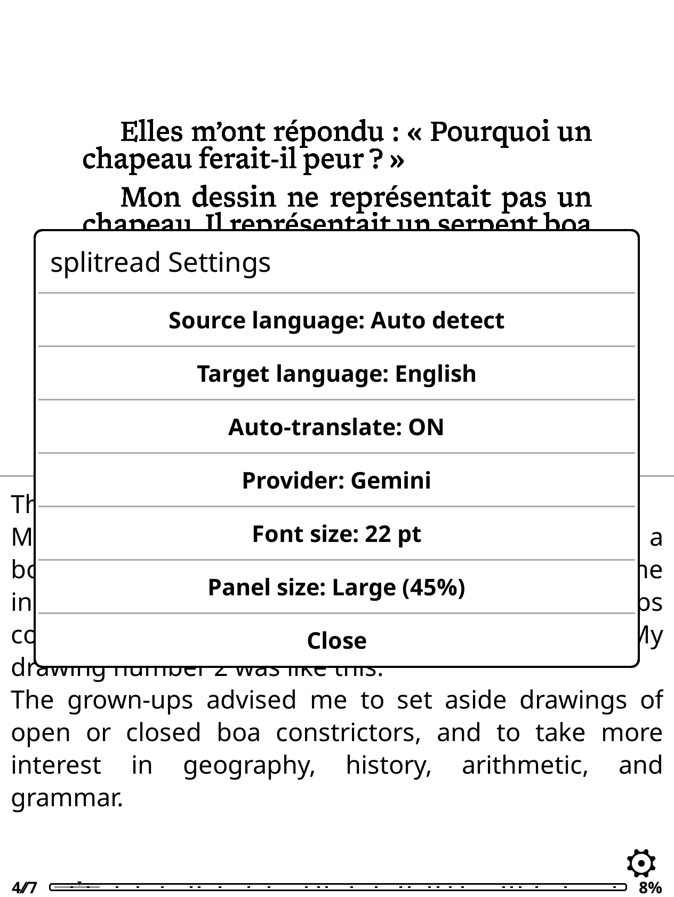

# splitread - Translation Panel for KOReader

A KOReader plugin that displays real-time translations in a split panel, designed for language learners reading foreign-language books.

---

## Screenshots

| Reading View | Settings |
|---|---|
|  |  |

---

## What It Does

Splitread divides your reading screen into two halves:
- **Top** - the original text, as normal
- **Bottom** - a live translation of the visible page, updating automatically as you turn pages

Translation is powered by KOReader's built-in Google Translate integration by default - no API key required. You can also use Gemini, or your own **local LLM** (any OpenAI-compatible server such as vLLM or llama.cpp), which can even read scanned or image-only pages (see [Using a local LLM](#using-a-local-llm)). An active network connection is needed for translations to work.

---

## Who Is It For?

It works best for readers who:
- Are at an intermediate level and can partially understand the original text
- Want to read authentic foreign-language books rather than graded readers

---

## Installation

1. Download the latest release from the [releases page](https://github.com/sadatdaniel/splitread.koplugin/releases) or clone this repository.
2. Copy the `splitread.koplugin` folder to your KOReader plugins directory:
   - **Kobo/Kindle:** `koreader/plugins/`
   - **Android:** `/sdcard/koreader/plugins/`
   - **Desktop (Linux):** `~/.config/koreader/plugins/`
3. Restart KOReader.

---

## Usage

### Enabling for a book

Splitread is disabled by default and must be enabled per book:

1. Open a book
2. Tap the top of the screen to open the reader menu
3. Tap the **NAVIGATION** menu (the menu that shows bookmarks, table of contents, and skim document)
4. Scroll to find **splitread** (maybe on the second page of options)
5. Tap **Enable for this book**

### Settings

While splitread is enabled, tap the **⚙** icon in the bottom-right corner of the translation panel to open settings:

- **Source language** - language of the book (default: Auto detect)
- **Target language** - language to translate into (default: English). Chinese comes in two entries, **Chinese (Simplified)** and **Chinese (Traditional)**, so you get the script you want. A setting saved as plain "Chinese" by an older version is read as Simplified.
- **Auto-translate** - toggle automatic translation on page turns
- **Provider** - allows you to switch between translation providers: Google Translate, Gemini, or a Local LLM. (To learn how to obtain a Gemini Translation API key, see the section further down this page)
- **Page input** - what is sent for translation: the page text, the page image (OCR), or **Auto** (text, falling back to the image when a page has no text). Images are only supported by the Local LLM provider.
- **Local LLM settings** - server URL and port, model, and system prompt for the Local LLM provider.
- **Translate this page now** - (re)translate the current page, bypassing the cache.
- **Font size** - adjust the translation panel font size

Settings are saved globally across all books.

### Disabling for a book

Go back to the same **NAVIGATION** menu -> **splitread** -> **Disable for this book**. The screen returns to normal.

### Using a local LLM

Any OpenAI-compatible server works, for example vLLM or llama.cpp. Choose **Provider -> Local LLM (OpenAI-compatible)**, then open **Local LLM settings...**:

- **Server** - address and port of any server that speaks the OpenAI `/chat/completions` API. All of these work:
  - `http://192.168.1.50:8000/v1`
  - `http://192.168.1.50:8080` (`/v1` is added for you)
  - `192.168.1.50:8080` (`http://` is added for you)
  - `https://llm.example.com/v1`

  On an e-reader, use the server's address on your network, **not** `localhost`. Start the server so that it listens on the network, not only on loopback.
- **Model** - tap it to get a list of the models your server reports (`GET /v1/models`) and pick one. **Auto** leaves the setting empty, so splitread asks the server each time and uses the first model it lists. **Type a name...** lets you enter a name by hand, which is also what you get when the server cannot list its models. vLLM needs the exact name it serves; llama.cpp ignores it.
- **System prompt** - sent as the system message, e.g. `You are a helpful translation agent for readers of 19th century German novels. Keep the archaic tone.` `{source}` and `{target}` are replaced by the language names. Empty means no system prompt. The **Default** button restores the built-in prompt. The request itself already says which languages to translate between, so the prompt only needs to describe the role and style.
- **Test connection** - contacts the server and lists its models.

If the server was started with an API key, add it to `keys.lua` (see `keys.lua.sample`):

```lua
return {
    local_llm = "your-server-api-key",
}
```

Example servers (for image pages you need a **vision** model):

```sh
# vLLM
vllm serve Qwen/Qwen2.5-VL-7B-Instruct --host 0.0.0.0 --port 8000

# llama.cpp (the --mmproj file is what adds image support)
llama-server -m Qwen2.5-VL-7B-Instruct-Q4_K_M.gguf --mmproj mmproj-Qwen2.5-VL-7B-Instruct-f16.gguf --host 0.0.0.0 --port 8080
```

#### Books made of images

With **Page input: Auto**, a page without text (a scanned PDF, a CBZ comic, an EPUB made of images) is sent to the LLM as a picture, together with the request to read its text (OCR) and translate it. Pages that do have text, including PDFs with a text layer, are still sent as text, which is faster. Choose **Page input: Page image** to always send the image, for example for scans with a poor text layer. Image translation needs a vision-capable model and is slower than text; translations are cached per page.

Reasoning models that print `<think>...</think>` blocks are fine: the thinking is removed from the translation.

Advanced values can be changed in `settings/splitread.lua` in the KOReader folder: `local_timeout` (seconds to wait for a reply, default 180) and `image_max_side` (pixels of the longer side of the page image, default 1600).

### Getting a Gemini API Key

1. Sign in to your Google account.

   > **Recommendation:** Use a separate Google account that does **not** have a payment method attached. This helps ensure you stay within the free tier and prevents accidental charges.

2. Go to **Google AI Studio**: https://aistudio.google.com/apikey

3. If prompted, create a new project.

4. Click **Create API Key** and copy the generated key.

5. **Keep your API key private.**
   - Never share it with anyone.

6. Create a file named `keys.lua`.

7. Add your API key following the template in `keys.lua.sample`:

   ```lua
   return {
       gemini = "your-gemini-api-key-here",
   }
   ```

8. Save the file and restart KOReader.

The Gemini translation provider is now ready to use.

---

## Requirements

- KOReader (tested on v2026.03)
- Active network connection (Google Translate via KOReader's built-in translator, Gemini, or your own server for the Local LLM provider)
- EPUB or other text-based formats. PDF, CBZ and DjVu work too: a text layer is translated as text, and pages without text are read by a vision model through the Local LLM provider.

---

## Tested On

- Kobo Libra H2O
- Linux (KOReader AppImage)

---

## Known Limitations

- The first and last lines of each page may be partially cut off at page boundaries - SplitRead stitches sentences across pages to compensate in the translation panel
- Very large font sizes in the translation panel may cause text to be clipped
- Requires WiFi/network for every page translation (the Local LLM provider only needs to reach your server)
- Requests are synchronous: the reader is busy while the translation of a page is being fetched, which can take a while with a local LLM, especially for page images

---

## Contributing

The project started as a personal solution, but I decided to share it in case others find it useful as well. I plan to continue developing and improving the plugin as new needs arise during my language learning journey.

Feature requests, bug reports, and pull requests are welcome.
