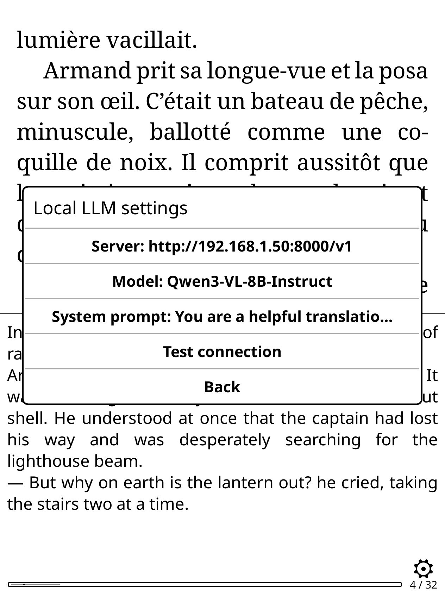
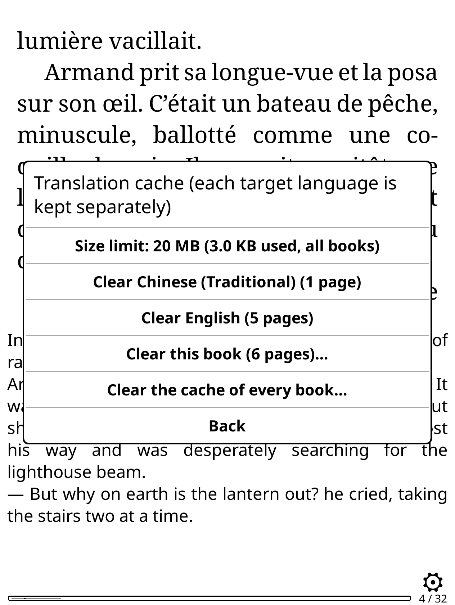

# splitread - Translation Panel for KOReader

A KOReader plugin that displays real-time translations in a split panel, designed for language learners reading foreign-language books.

---

## Screenshots


*Demo (41 s, [full quality MP4](screenshots/demo.mp4)): a French story translated by a local LLM; **Pre-translate** is switched on and translates the next pages in the background while the reader stays usable; then the target language is changed to Traditional Chinese. Where the video says "sped up", the waiting for the LLM was shortened.*

| Reading View | Traditional Chinese | Settings |
|---|---|---|
|  |  |  |

| Local LLM settings | Translation cache |
|---|---|
|  |  |

*A French demo story (original text, written for these screenshots) translated by a local LLM. Look at the translation of the page: it starts with the beginning of the sentence that began on the previous page, and ends with the sentence that continues on the next one. The server address and model in the Local LLM settings are examples.*

---

## What It Does

Splitread divides your reading screen into two halves:
- **Top** - the original text, as normal
- **Bottom** - a live translation of the visible page, updating automatically as you turn pages

The translation is tidied before it is shown: the blank lines that models like to put between paragraphs are removed (unless the page text itself has blank lines), so the panel does not waste vertical space.

Translation is powered by KOReader's built-in Google Translate integration by default - no API key required. You can also use Gemini, or your own **local LLM** (any OpenAI-compatible server such as vLLM or llama.cpp), which can even read scanned or image-only pages (see [Using a local LLM](#using-a-local-llm)). An active network connection is needed for translations to work.

---

## Who Is It For?

It works best for readers who:
- Are at an intermediate level and can partially understand the original text
- Want to read authentic foreign-language books rather than graded readers

---

## Installation

1. Download the latest release from the [releases page](https://github.com/sadatdaniel/splitread.koplugin/releases) or clone this repository.
2. Copy the `splitread.koplugin` folder to your KOReader plugins directory:
   - **Kobo/Kindle:** `koreader/plugins/`
   - **Android:** `/sdcard/koreader/plugins/`
   - **Desktop (Linux):** `~/.config/koreader/plugins/`
3. Restart KOReader.

---

## Usage

### Enabling for a book

Splitread is disabled by default and must be enabled per book:

1. Open a book
2. Tap the top of the screen to open the reader menu
3. Tap the **NAVIGATION** menu (the menu that shows bookmarks, table of contents, and skim document)
4. Scroll to find **splitread** (maybe on the second page of options)
5. Tap **Enable for this book**

### Settings

While splitread is enabled, tap the **⚙** icon in the bottom-right corner of the translation panel to open settings:

- **Source language** - language of the book (default: Auto detect)
- **Target language** - language to translate into (default: English). Chinese comes in two entries, **Chinese (Simplified)** and **Chinese (Traditional)**, so you get the script you want. A setting saved as plain "Chinese" by an older version is read as Simplified.
- **Auto-translate** - toggle automatic translation on page turns
- **Pre-translate** - translate the next 1, 2, 3, 5 or 10 pages in the background, so that turning the page finds the translation ready (default: off). See [Pre-translation](#pre-translation).
- **Provider** - allows you to switch between translation providers: Google Translate, Gemini, or a Local LLM. (To learn how to obtain a Gemini Translation API key, see the section further down this page)
- **Page input** - what is sent for translation: the page text, the page image (OCR), or **Auto** (text, falling back to the image when a page has no text). Images are only supported by the Local LLM provider.
- **Local LLM settings** - server URL and port, model, and system prompt for the Local LLM provider.
- **Translation cache** - what is saved for this book, per language, and the size limit. See [Translation cache](#translation-cache).
- **Translate this page now** - (re)translate the current page, bypassing the cache.
- **Font size** - adjust the translation panel font size

Settings are saved globally across all books.

### Disabling for a book

Go back to the same **NAVIGATION** menu -> **splitread** -> **Disable for this book**. The screen returns to normal.

### Translation cache

Every translation is saved on disk as soon as it arrives, so a page is never translated twice, also not after closing the book or restarting KOReader, and cached pages are shown without a network connection.

- **Per book and per language.** The cache lives in `splitread_cache/` in the KOReader folder: one folder per book, and in it one file per target language (`zh-CN.jsonl`, `zh-TW.jsonl`, `en.jsonl`, ...). A page translated into Simplified and into Traditional Chinese is two separate entries, and so are translations by different providers, from different source languages, or by different local models or system prompts. Only the file of the language you are reading is loaded.
- **Keyed by the text.** A translation is found again by the text that was translated, not by its page number, so changing the font size (which re-flows an EPUB) never shows the translation of another page. Go back to the old font size and the old translations are found again.
- **Size limit.** The cache of all books together may take at most **20 MB** (change it under **Translation cache > Size limit**: 1, 5, 10, 20, 50, 100, 200 MB, or no limit; `cache_max_mb` in `settings/splitread.lua`). When a save pushes it over the limit, the oldest-used data is removed automatically, down to 90% of the limit: first the language files of other books and languages that were used least recently, and only then the oldest entries of the language you are reading (an entry you read counts as new). Lowering the limit takes effect at once.
- **Clearing.** **Translation cache** lists the languages saved for this book with their page counts; each can be cleared on its own, or the whole book, or the cache of every book (these last two ask for confirmation first and tell you how much they will delete). **Clear all translation cache...** in the splitread menu (NAVIGATION menu -> **splitread**) deletes the cache of every book without opening the settings. **Translate this page now** ignores the cache and replaces the entry.

### Pre-translation

With **Pre-translate** set to 1-10 pages (and **Auto-translate** on), splitread translates the pages after the current one in the background, one at a time, starting a second after the current page is done. The answers go into the cache, so turning the page shows the translation immediately.

- The request runs in a separate process, so the reader stays responsive even if the server needs a minute per page. If you turn to a page that is being translated at that moment, the panel says "Translating..." and shows the text as soon as it arrives.
- Each pre-translated page is one request to the provider: mind the quota of Gemini, or Google's rate limit. After a failure, pre-translation pauses for a minute.
- Pages of a PDF/CBZ/DjVu that need the page image (scans) are pre-translated too; an EPUB page that is not on the screen cannot be rendered, so image-only EPUB pages are not.
- It stops when you close or disable the book, and never goes past the last page.

### Sentences across page breaks

A sentence that is cut in two by a page break is translated whole: when a page ends in the middle of a sentence, the rest of it is read from the following page(s), and when a page begins with the end of a sentence, its beginning is put in front. Sentence ends are recognized for Latin, Cyrillic, Greek, CJK (`。！？`), Arabic, Devanagari and other scripts, including closing quotes (`"Where?" she asked.` is one sentence), ellipses and common abbreviations (`Mr.`, `J. R. R.`, `z. B.`).

### Using a local LLM

Any OpenAI-compatible server works, for example vLLM or llama.cpp. Choose **Provider -> Local LLM (OpenAI-compatible)**, then open **Local LLM settings...**:

- **Server** - address and port of any server that speaks the OpenAI `/chat/completions` API. All of these work:
  - `http://192.168.1.50:8000/v1`
  - `http://192.168.1.50:8080` (`/v1` is added for you)
  - `192.168.1.50:8080` (`http://` is added for you)
  - `https://llm.example.com/v1`

  On an e-reader, use the server's address on your network, **not** `localhost`. Start the server so that it listens on the network, not only on loopback.
- **Model** - tap it to get a list of the models your server reports (`GET /v1/models`) and pick one. **Auto** leaves the setting empty, so splitread asks the server each time and uses the first model it lists. **Type a name...** lets you enter a name by hand, which is also what you get when the server cannot list its models. vLLM needs the exact name it serves; llama.cpp ignores it.
- **System prompt** - sent as the system message, e.g. `You are a helpful translation agent for readers of 19th century German novels. Keep the archaic tone.` `{source}` and `{target}` are replaced by the language names. Empty means no system prompt. The **Default** button restores the built-in prompt. The request itself already says which languages to translate between, so the prompt only needs to describe the role and style. The target language of the settings is always stated again after your prompt, so a prompt that names a language (for example "translate into Simplified Chinese") cannot override the **Target language** setting; leave languages out of your prompt, or use `{target}`.
- **Test connection** - contacts the server and lists its models.

If the server was started with an API key, add it to `keys.lua` (see `keys.lua.sample`):

```lua
return {
    local_llm = "your-server-api-key",
}
```

Example servers (for image pages you need a **vision** model):

```sh
# vLLM
vllm serve Qwen/Qwen2.5-VL-7B-Instruct --host 0.0.0.0 --port 8000

# llama.cpp (the --mmproj file is what adds image support)
llama-server -m Qwen2.5-VL-7B-Instruct-Q4_K_M.gguf --mmproj mmproj-Qwen2.5-VL-7B-Instruct-f16.gguf --host 0.0.0.0 --port 8080
```

#### Books made of images

With **Page input: Auto**, a page without text (a scanned PDF, a CBZ comic, an EPUB made of images) is sent to the LLM as a picture, together with the request to read its text (OCR) and translate it. Pages that do have text, including PDFs with a text layer, are still sent as text, which is faster. Choose **Page input: Page image** to always send the image, for example for scans with a poor text layer. Image translation needs a vision-capable model and is slower than text; translations are cached per page.

Reasoning models that print `<think>...</think>` blocks are fine: the thinking is removed from the translation.

Advanced values can be changed in `settings/splitread.lua` in the KOReader folder: `local_timeout` (seconds to wait for a reply, default 180) and `image_max_side` (pixels of the longer side of the page image, default 1600).

### Getting a Gemini API Key

1. Sign in to your Google account.

   > **Recommendation:** Use a separate Google account that does **not** have a payment method attached. This helps ensure you stay within the free tier and prevents accidental charges.

2. Go to **Google AI Studio**: https://aistudio.google.com/apikey

3. If prompted, create a new project.

4. Click **Create API Key** and copy the generated key.

5. **Keep your API key private.**
   - Never share it with anyone.

6. Create a file named `keys.lua`.

7. Add your API key following the template in `keys.lua.sample`:

   ```lua
   return {
       gemini = "your-gemini-api-key-here",
   }
   ```

8. Save the file and restart KOReader.

The Gemini translation provider is now ready to use.

---

## Requirements

- KOReader (tested on v2026.03)
- Active network connection (Google Translate via KOReader's built-in translator, Gemini, or your own server for the Local LLM provider)
- EPUB or other text-based formats. PDF, CBZ and DjVu work too: a text layer is translated as text, and pages without text are read by a vision model through the Local LLM provider.

---

## Tested On

- Kobo Libra H2O
- Linux (KOReader AppImage)

---

## Known Limitations

- The first and last lines of each page may be partially cut off at page boundaries - SplitRead reads the rest of the sentence from the next page (and the start from the previous one) to compensate in the translation panel. Sentence ends are found heuristically, so an unusual abbreviation can cut a sentence short; the read-ahead is limited to about 900 characters / 3 pages
- Very large font sizes in the translation panel may cause text to be clipped
- Requires WiFi/network for every page that is not in the cache yet (the Local LLM provider only needs to reach your server)
- The page you are on is translated in the foreground: the reader is busy while that request runs, which can take a while with a local LLM, especially for page images. Pre-translating the next pages avoids the wait on later pages

---

## Contributing

The project started as a personal solution, but I decided to share it in case others find it useful as well. I plan to continue developing and improving the plugin as new needs arise during my language learning journey.

Feature requests, bug reports, and pull requests are welcome.
